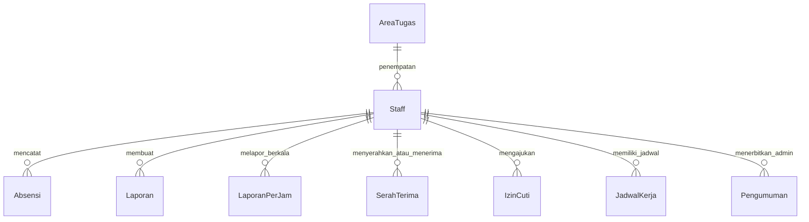

# Data Model — SIAP

## Data inventory

Basis data utama menggunakan **PostgreSQL 16** yang dimodelkan via Prisma di `backend/prisma/schema.prisma` (10 model tabel dan 10 enum), serta penyimpanan lokal offline **SQLite** di aplikasi mobile melalui `op-sqlite` (`mobile/src/store/database.ts`).

| ID | Entitas / Tabel | Sumber Bukti | Status |
| --- | --- | --- | --- |
| **MODEL-001** | `AreaTugas` (`area_tugas`) | `backend/prisma/schema.prisma#L106-L119` | Observed |
| **MODEL-002** | `Staff` (`staff`) | `backend/prisma/schema.prisma#L121-L151` | Observed |
| **MODEL-003** | `Absensi` (`absensi`) | `backend/prisma/schema.prisma#L153-L170` | Observed |
| **MODEL-004** | `Laporan` (`laporan`) | `backend/prisma/schema.prisma#L172-L193` | Observed |
| **MODEL-005** | `LaporanPerJam` (`laporan_perjam`) | `backend/prisma/schema.prisma#L195-L213` | Observed |
| **MODEL-006** | `SerahTerima` (`serah_terima`) | `backend/prisma/schema.prisma#L215-L241` | Observed |
| **MODEL-007** | `RevokedToken` (`revoked_tokens`) | `backend/prisma/schema.prisma#L243-L252` | Observed |
| **MODEL-008** | `IzinCuti` (`izin_cuti`) | `backend/prisma/schema.prisma#L254-L274` | Observed |
| **MODEL-009** | `JadwalKerja` (`jadwal_kerja`) | `backend/prisma/schema.prisma#L278-L294` | Observed |
| **MODEL-010** | `PengaturanSistem` (`pengaturan_sistem`), `Pengumuman` (`pengumuman`), & `absensi_offline` (SQLite) | `backend/prisma/schema.prisma#L299-L326`, `mobile/src/store/database.ts` | Observed |

## Entities and relationships

Ringkasan skema terobservasi (`backend/prisma/schema.prisma`):
- **MODEL-001** (`AreaTugas`): `id` (cuid PK), `nama`, `lat` (Float), `lng` (Float), `radius_meter` (Int, default `500`), `aktif` (Boolean, default `true`), `created_at`, `updated_at`.
- **MODEL-002** (`Staff`): `id` (cuid PK), `nik` (String unique), `nama`, `password_hash`, `foto_profil` (nullable), `role` (`SATPAM | CS | UTILITY | ADMIN`), `divisi` (`KEAMANAN | CUSTOMER_SERVICE | UTILITY | MANAJEMEN`), `area_tugas_id` (FK nullable ke `AreaTugas`), `fcm_token` (nullable), `aktif` (default `true`), indeks pada `area_tugas_id`, `aktif`, `role`, `divisi`.
- **MODEL-003** (`Absensi`): `id` (cuid PK), `staff_id` (FK ke `Staff`), `jenis` (`MASUK | KELUAR | MULAI_ISTIRAHAT | SELESAI_ISTIRAHAT`), `foto_url` (nullable), `lat` (nullable), `lng` (nullable), `akurasi_gps` (nullable), `waktu_server` (DateTime default `now()`), `catatan` (nullable), indeks pada `staff_id`, `waktu_server`, `[staff_id, waktu_server]`.
- **MODEL-004** (`Laporan`): `id` (cuid PK), `staff_id` (FK ke `Staff`), `divisi` (`Divisi`), `kategori` (`KategoriLaporan`), `judul`, `deskripsi` (`Text`), `foto_urls` (`Json`, default `[]`), `status` (`DRAFT | SUBMITTED | APPROVED | REJECTED`, default `DRAFT`), `komentar_admin` (nullable), indeks pada `staff_id`, `divisi`, `status`, `[staff_id, created_at]`, `[divisi, status]`.
- **MODEL-005** (`LaporanPerJam`): `id` (cuid PK), `staff_id` (FK ke `Staff`), `tanggal` (`@db.Date`), `jam` (`Int` 0-23), `status_keamanan` (`AMAN | ADA_TEMUAN | PERLU_PERIKSA`), `foto_url` (nullable), `catatan` (nullable), unique constraint `@@unique([staff_id, tanggal, jam])`.
- **MODEL-006** (`SerahTerima`): `id` (cuid PK, diisi UUID di controller), `staff_lama_id` (FK `StaffLama`), `staff_baru_id` (FK `StaffBaru`), `jenis` (`PIKET | PERALATAN`), `shift_date` (`@db.Date`), `barang_list` (`Json` array objek `{ nama, kondisi, catatan }`), `catatan` (nullable), `foto_urls` (`Json`), `ttd_lama_url`, `ttd_baru_url`, `bast_pdf_url` (nullable), `status` (`PENDING | SELESAI`), indeks pada `staff_lama_id`, `staff_baru_id`, `jenis`, `shift_date`, `status`.
- **MODEL-007** (`RevokedToken`): `id` (cuid PK), `token_jti` (unique), `expired_at` (DateTime), `created_at`, indeks pada `token_jti` dan `expired_at`.
- **MODEL-008** (`IzinCuti`): `id` (cuid PK), `staff_id` (FK ke `Staff`), `jenis` (`IZIN | CUTI | SAKIT`), `tanggal_mulai` (`@db.Date`), `tanggal_selesai` (`@db.Date`), `keterangan` (`Text`), `foto_url` (nullable), `status` (`PENDING | APPROVED | REJECTED`), `komentar_admin` (nullable).
- **MODEL-009** (`JadwalKerja`): `id` (cuid PK), `staff_id` (FK ke `Staff`), `hari` (`SENIN | SELASA | RABU | KAMIS | JUMAT | SABTU | AHAD`), `jam_masuk` (`"HH:MM"`), `jam_keluar` (`"HH:MM"`), `aktif` (default `true`), unique constraint `@@unique([staff_id, hari])`.
- **MODEL-010** (`PengaturanSistem`, `Pengumuman`, & SQLite lokal): `PengaturanSistem` adalah singleton (`id = "singleton"`) menyimpan `toleransi_keterlambatan_menit` (default `15`). `Pengumuman` menyimpan `judul`, `konten`, `tipe` (`INFO | PENTING | UPDATE`), `admin_id` (FK ke `Staff`). Di mobile (`mobile/src/store/database.ts`), tabel `absensi_offline` menyimpan `id`, `jenis`, `lat`, `lng`, `foto_uri`, `waktu_lokal`, `status` (`pending`/`synced`).

## Lifecycle and retention

- **Migrasi Terobservasi:** Terdapat 3 file migrasi di `backend/prisma/migrations/` (`20260529050236_init_schema_v2`, `20260605084326_add_foto_profil`, `20260607_add_jadwal_and_pengaturan_sistem`). Status pada database Docker lokal saat pemeriksaan adalah up-to-date.
- **Pembersihan Token:** Cron job tengah malam (`0 0 * * *`) di `backend/src/index.ts` menghapus baris `revoked_tokens` yang memiliki `expired_at < now()`.
- **Backup Database:** Skrip `infra/backup.sh` melakukan `pg_dump` terkompresi gzip dengan retensi lokal 30 hari (belum terdaftar otomatis di cron host).
- **Retensi Data Operasional & Objek MinIO:** Penghapusan/retensi riwayat `Absensi`, `Laporan`, `IzinCuti`, `SerahTerima`, serta objek gambar/PDF di MinIO saat ini bersifat permanen (tanpa kebijakan penghapusan otomatis atau soft-delete di skema).

## Not applicable or unresolved

- **Observed (Diselesaikan pada M1):** `ROLE_DIVISI_MAP` pada `backend/src/schemas/admin.schema.ts` dan `updateStaff` (`admin.controller.ts`) kini menegakkan pasangan konsisten `role` <-> `divisi` di backend.
- **Catatan Skema Opsional (`Absensi.waktu_offline`):** Tabel `Absensi` di `schema.prisma` menggunakan `waktu_server` sebagai timestamp otoritatif antrean maupun live; penambahan kolom `waktu_offline` opsional dapat ditambahkan pada migrasi mendatang bila audit timestamp perangkat luring dibutuhkan.
- **Not applicable — Penyimpanan Data AI/Vector**: Tidak ada tabel embedding, memori agen, atau log LLM karena fitur AI tidak digunakan (`features.ai = false`).

