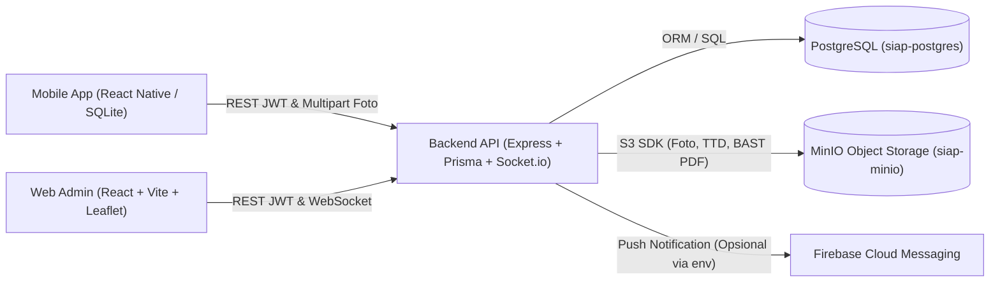

# SIAP — Sistem Informasi Absensi & Pelaporan Lapangan

## Overview

**SIAP** adalah platform manajemen kehadiran, patroli laporan per jam, serah terima shift (BAST PDF), perizinan, serta pemantauan operasional real-time untuk staf lapangan (Keamanan, Kebersihan, dan Taman) dan administrator. Proyek ini terdiri dari tiga komponen kode utama yang saling terintegrasi di monorepo `siap-app`: API & WebSocket backend (`backend/`), dasbor administrasi web (`web-admin/`), dan aplikasi mobile React Native (`mobile/`). Suite dokumentasi di direktori `docs/` mendokumentasikan arsitektur aktual berbasis bukti kode sekaligus rencana terstruktur untuk menutup seluruh celah menuju penyelesaian 100%.

## Status

- **Lifecycle Dokumentasi:** `existing` (bahasa utama: `id`, `features.ai = false`, `architect-docs.config.json`).
- **Status Runtime & Verifikasi Lokal (Observed):**
  - Infrastruktur Docker lokal (`siap-postgres` port `5432` dengan `siap_db` & `siap_test_db`, `siap-minio` port `9000`/`9001`), server backend (`http://localhost:3000/health` HTTP `200`), dan Web Admin (`http://localhost:5173/` HTTP `200`) **berjalan**.
  - Aplikasi Mobile (`mobile/`) tervalidasi melalui ESLint (`0` errors), sedangkan eksekusi emulator Android belum dijalankan pada sesi Windows ini (`Not run`).
- **Status Kesiapan Produk (Pasca-Eksekusi M1–M4):** Seluruh perbaikan kode lintas-layer **M1–M4** ([IMPLEMENTATION.md](IMPLEMENTATION.md)) telah diimplementasikan dan diverifikasi melalui kompilasi/lint serta `4` suite (`16` kasus uji) integrasi backend terhadap `siap_test_db`; tersisa pengukuran beban `NFR-005`, aktivasi TLS sertifikat Nginx produksi, dan uji emulator Android interaktif. Lihat [_AUDIT_REPORT.md](_AUDIT_REPORT.md).

## Scope

- **Dalam Cakupan:**
  - Autentikasi JWT & token revocation (`staff_id` + PIN), RBAC (`STAFF` & `ADMIN`), serta batas perangkat/sesi.
  - Absensi berbasis GPS Haversine + swafoto ber-watermark SVG/Sharp + dukungan antrean offline SQLite mobile.
  - Laporan kegiatan per jam (`LaporanPerJam`), serah terima shift dengan tanda tangan digital + BAST PDF (`PDFKit`), pengajuan izin/cuti, jadwal shift, dan pengumuman.
  - Pemantauan lokasi staf & feed aktivitas real-time melalui Socket.io di Web Admin.
- **Di Luar Cakupan (Tidak Berlaku):**
  - **N/A — AI/LLM Runtime**: Tidak ada integrasi model bahasa, prompt runtime, atau agen AI pada seluruh komponen `siap-app` (`features.ai = false`).

## Quick start

Prasyarat terobservasi: Node.js, Docker Desktop (PostgreSQL + MinIO), dan Python (untuk CLI `architect-docs-engine`).

1. **Jalankan infrastruktur database & object storage:**
   ```powershell
   docker compose -f infra/docker-compose.yml up -d
   ```
2. **Migrasi, seed (opsional), dan jalankan Backend (`http://localhost:3000`):**
   ```powershell
   cd backend
   npx prisma migrate deploy
   npm run dev
   ```
3. **Jalankan Web Admin (`http://localhost:5173`):**
   ```powershell
   cd web-admin
   npm run dev
   ```
4. **Verifikasi awal yang terobservasi:** Cek endpoint `GET http://localhost:3000/health` dan buka `http://localhost:5173/` di peramban (lihat [OPERATIONS.md](OPERATIONS.md) dan [AGENTS.md](AGENTS.md) untuk perintah lengkap).

## Architecture



> Catatan implementasi: koneksi Socket.io di `web-admin` (`dashboard.tsx`) sudah mengirim JWT `auth.token` dan mendengarkan event resmi (`location:snapshot`, `location:updated`, `absensi:new`, `laporan:new`, `serah_terima:new`); sinkronisasi offline mobile (`NetworkManager.tsx`) sudah memetakan `item.jenis` ke `/absensi/masuk`, `/absensi/keluar`, `/absensi/mulai-istirahat`, dan `/absensi/selesai-istirahat`.

## Project map

| Direktori / File | Peran | Catatan Kondisi |
| --- | --- | --- |
| [../backend/](../backend/package.json) | Backend Express + TypeScript + Prisma + Socket.io + MinIO S3 + PDFKit | Berjalan di `:3000`; `tsc`, `lint`, `build`, dan `4/4` suite Jest (`16` tes) terobservasi lulus terhadap `siap_test_db` |
| [../web-admin/](../web-admin/package.json) | Web Admin React + TanStack Router + TanStack Query + Tailwind + Leaflet | Berjalan di `:5173`; terhubung ke Socket.io ber-JWT, chart agregasi riil, drawer responsif, dan `lint`/`build` lulus |
| [../mobile/](../mobile/package.json) | Aplikasi Android React Native + Paper + `op-sqlite` + VisionCamera | `eslint` `0` error; offline sync, endpoint serah terima, dan tema `#006e2f` telah diselaraskan (emulator Android belum dijalankan) |
| [../infra/](../infra/docker-compose.yml) | Konfigurasi Docker Compose lokal/produksi & Nginx reverse proxy | Bucket `siap-storage` (`MINIO_BUCKET`), `MINIO_PUBLIC_URL`, proxy `/socket.io/` dan `/storage/` telah diselaraskan |

## Glossary

- **SIAP:** Sistem Informasi Absensi & Pelaporan Lapangan untuk staf keamanan, kebersihan, dan pertamanan.
- **BAST:** Berita Acara Serah Terima shift antara staf lama (`staff_lama`) dan staf baru (`staff_baru`) dalam format PDF bertanda tangan digital.
- **Haversine Radius:** Perhitungan jarak geografis antara koordinat GPS perangkat dan `AreaTugas` terhadap `radius_meter`.
- **Watermark SVG:** Lapisan metadata (nama, ID staf, area tugas, timestamp, koordinat) yang ditempelkan ke foto melalui Sharp sebelum diunggah ke MinIO.

## Document index

| Dokumen | Deskripsi Singkat |
| --- | --- |
| [PRD.md](PRD.md) | Kebutuhan produk, batasan, kebutuhan fungsional (`REQ`) dan non-fungsional (`NFR`), serta keputusan terbuka |
| [TECH_STACK.md](TECH_STACK.md) | Inventaris stack terobservasi, usulan perbaikan, alternatif, dan kebijakan upgrade |
| [DECISIONS.md](DECISIONS.md) | Catatan keputusan arsitektur (`ADR-001` s.d. `ADR-006`) |
| [DATA_MODEL.md](DATA_MODEL.md) | Skema 10 tabel Prisma PostgreSQL (`MODEL-001` s.d. `MODEL-010`), relasi, indeks, dan retensi |
| [VALIDATION_RULES.md](VALIDATION_RULES.md) | Aturan validasi masukan (`zod`), celah validasi saat ini, dan pesan error |
| [API_CONTRACT.md](API_CONTRACT.md) | Kontrak 18 antarmuka REST & WebSocket (`EP-001` s.d. `EP-018`) beserta ketidakcocokan klien |
| [UI.md](UI.md) | Sistem visual Web Admin & Mobile (`UI-001` s.d. `UI-016`), konflik 3 dokumen desain, dan token |
| [UX.md](UX.md) | Alur perjalanan pengguna (`FLOW-001` s.d. `FLOW-012`), status interaksi, dan pemulihan error |
| [AGENTS.md](AGENTS.md) | Panduan kerja agen AI/developer untuk repositori `siap-app` |
| [PROMPTS.md](PROMPTS.md) | Inventaris AI (tidak ada AI runtime) serta pola prompt review kode internal |
| [SECURITY.md](SECURITY.md) | Batas kepercayaan, model ancaman, RBAC/IDOR, keamanan upload, rahasia, dan risiko terbuka |
| [SEED.md](SEED.md) | Strategi fixture deterministik dari `backend/prisma/seed.ts` dan pemisahan produksi |
| [IMPLEMENTATION.md](IMPLEMENTATION.md) | Rencana eksekusi perbaikan **M1–M4** menuju penyelesaian 100% |
| [TESTING.md](TESTING.md) | Strategi uji, kasus uji (`TC-001` s.d. `TC-016`), dan status eksekusi (`Not run`) |
| [ACCEPTANCE.md](ACCEPTANCE.md) | Kriteria penerimaan berbasis cerita pengguna (`US-001` s.d. `US-012`) |
| [TRACEABILITY.md](TRACEABILITY.md) | Matriks keterlacakan penuh antar-ID kanonik dan cakupan terpetakan |
| [OPERATIONS.md](OPERATIONS.md) | Topologi lokal/produksi, startup, healthcheck, backup, dan prosedur insiden |
| [AUDIT.md](AUDIT.md) | Metodologi audit, rubrik 100 poin, hard fail, dan ulasan manusia |
| [_AUDIT_REPORT.md](_AUDIT_REPORT.md) | Rekaman audit terbaru berbasis eksekusi `cli.py` |
| [_CHANGELOG.md](_CHANGELOG.md) | Riwayat versi suite dokumentasi `docs/` |
